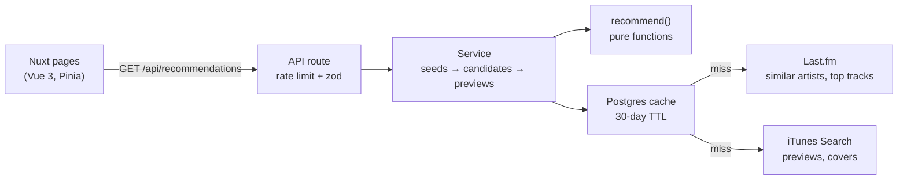

# Music Recs

**Live demo: [music-recs-roan.vercel.app](https://music-recs-roan.vercel.app/)**

Pick up to three artists you love and get ten records to flip through, each with a 30-second preview. From any record you can **explore** one level deeper, up to three levels, and every level shows artists you haven't seen yet. No account and no sign-in.

> **Status**: a one-week portfolio project (November 2026). Recommendations, previews, Explore and rate limiting are live. The blind test that measures recommendation quality is next. See [What's next](#whats-next).

## Features

- **Seed artists**: type-ahead search backed by Last.fm, with misspelled lookalikes filtered out (for example "radıohead" with a dotless ı). Choose 1–3 artists; they're remembered in the browser.
- **A crate of records**: ten recommendations shown like flipping through a record crate. Swipe, drag, click the side covers or use the arrow keys. Each record shows the artist, a representative track, which of your artists it's similar to, and a round play button for the preview.
- **Explore from here**: dig from any record into artists similar to it, up to three levels deep. Each level excludes everything shown before, so you always get new names. A breadcrumb (`Home › Tame Impala + Kokoroko › Pond`) goes back to any level instantly, without refetching.
- **Shareable URLs**: the URL is the single source of truth (`/recommendations?seed=…&explore=…`), so reload, Back and shared links all show the same screen, rendered on the server.
- **Graceful gaps**: no preview in any store shows "No preview" with an Apple Music link; a temporary iTunes error affects only that record and offers a retry; an unknown artist suggests similar names.
- **One screen, every size**: both pages fit exactly one viewport from a 320px phone to a 1920px desktop, with motion that respects the system's reduced-motion setting.

## How it works



1. **Similar artists**: for each seed, take Last.fm's similar-artists list (cached in Postgres for 30 days).
2. **Merge by rank**: combine the lists with Reciprocal Rank Fusion, a common way search engines merge ranked lists. Rank *r* in a seed's list scores `1 / (5 + r)`, summed across seeds. Using ranks instead of raw similarity scores keeps one seed from taking most of the spots, while artists similar to several seeds still rank highest.
3. **Exclude**: drop the seeds themselves (matched by normalized name or MusicBrainz ID), plus everything already shown when exploring.
4. **Previews**: for each of the top 10, take Last.fm's top track and find it on iTunes, trying the Taiwan, US and Japan stores in turn (stores localize artist names, e.g. BoA is 寶兒 in Taiwan). A small tiered matcher prefers the original title, then a version of it, and never a different artist's song.

Every result is tagged with an algorithm version so future blind-test ratings can compare versions.

## Stack and why

| Area | Choice | Why |
|---|---|---|
| Framework | **Nuxt 4** (Vue 3, strict TypeScript) | Pages and API in one project, with server rendering. A separate SPA + API would be closer to many company setups, but too much for a one-week MVP |
| State | **Pinia**, **VueUse** | Seeds in a small store synced to localStorage (with an SSR-safe hydration fix) |
| Styling | **Tailwind CSS v4** | Design tokens in one `@theme` block; custom `short` / `tall` / `wide` variants keep responsive rules from competing, with no `!important` |
| Motion | **Motion for Vue** (`motion-v`) | Springs, layout animations and enter/exit transitions that CSS transitions can't do, plus a View Transition that morphs the turntable between pages |
| Database | **Postgres 17** + **Drizzle ORM** | Caches Last.fm and iTunes data and stores rate-limit counters. Docker locally, Neon in production |
| Validation | **zod** | Every external API response and every request is validated and reshaped at the boundary, so bad data never reaches the algorithm |
| Data | **Last.fm API**, **iTunes Search API** | No user sign-in needed. Spotify was ruled out: its development mode now allows only a few users. Deezer was ruled out: it isn't available in Taiwan |
| Tests | **Vitest** + `@nuxt/test-utils` | Three projects: pure functions in Node, database tests against a real Postgres, components in happy-dom |
| Hosting | **Vercel** + **Neon** | Serverless deploys with a managed Postgres |

## Engineering notes

- **Test-driven**: 218 tests. The algorithm and rate limiting are pure functions with unit tests; caching and services run against a real test database; pages and components are tested in a simulated browser. External APIs are never called in tests: recorded fixtures stand in for them.
- **Caching that won't lie**: "iTunes has no preview" is cached (so we don't ask again for 30 days); "iTunes is down" is not (so the preview comes back when it recovers).
- **Rate limiting**: fixed one-minute windows counted atomically in Postgres, because serverless instances don't share memory. IPv6 clients are grouped by /64, `x-forwarded-for` is trusted only behind Vercel's proxy, and only a salted hash of the IP is stored.
- **Protecting upstream APIs**: one uncached recommendation can make dozens of Last.fm and iTunes calls, so there's also a site-wide per-minute budget for each API and a circuit breaker that backs off iTunes for five minutes when it starts throttling.
- **Security headers**: in production, a Content Security Policy, `frame-ancestors 'none'` against clickjacking, `nosniff`, a referrer policy and HSTS. Media URLs from iTunes must be https.
- **Privacy**: no accounts and no personal data. Your chosen artists are stored only in your browser; the server keeps salted IP hashes for rate limiting and deletes them after about an hour.

The reasoning behind each decision, including the ones that were tried and reverted, is in [`docs/ai-log.md`](docs/ai-log.md). Concepts are explained for a frontend engineer in [`docs/concepts.md`](docs/concepts.md). The full spec is [`SPEC.md`](SPEC.md).

## Running it locally

Requirements: Node 24, pnpm, Docker, and a free [Last.fm API key](https://www.last.fm/api/account/create).

```bash
cp .env.example .env
```

Fill in `LASTFM_API_KEY`, and generate a salt for `RATE_LIMIT_SALT`:

```bash
openssl rand -hex 32
```

Then:

```bash
pnpm install
```

```bash
pnpm db:up
```

```bash
pnpm db:migrate
```

```bash
pnpm dev
```

Open http://localhost:3000.

| Command | Purpose |
|---|---|
| `pnpm test` | All tests (needs `pnpm db:up` for the database tests) |
| `pnpm typecheck` / `pnpm lint` | Type check and lint |
| `pnpm db:studio` | Browse the cached data in Drizzle Studio |
| `pnpm record:lastfm` / `pnpm record:itunes` | Re-record API fixtures from the real APIs |

## Project structure

```
app/                 Vue pages, components, composables and stores
  pages/             index (pick artists), recommendations (the crate)
  components/        RecordCrate, SeedInput, SunTurntable, VinylRecord
server/
  api/               HTTP routes: validation, rate limiting, error mapping
  services/          Wiring: recommendations, rate limits, external API budgets
  cache/             Cache-aside over Postgres for Last.fm and iTunes data
  utils/recommend/   The recommendation algorithm (pure functions)
  lastfm/, itunes/   API clients with zod schemas and recorded fixtures
  db/                Drizzle schema and generated migrations
shared/              Types and helpers used by both sides
docs/                Decision log, concept notes, exercises
```

## What's next

- **Blind test**: listen to three songs, rate each, then see which were recommended and which came from a same-genre control group. The eval is the average rating difference between recommended and control songs, with a confidence interval, counted once per visitor.
- **Recommendation reasons** written by an LLM, cached and capped per day. Until then, each record says which of your artists it's similar to.

## Credits

Artist data from [Last.fm](https://www.last.fm/). Previews and covers from the [iTunes Search API](https://performance-partners.apple.com/search-api). Non-commercial use.
